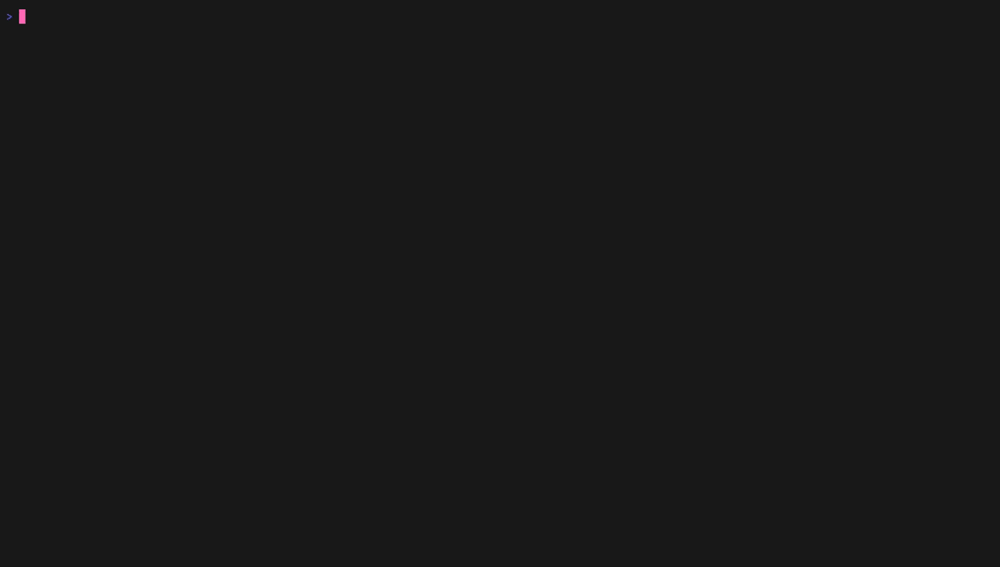

<h1 align="center">
  <picture>
    <source media="(prefers-color-scheme: dark)" srcset="assets/panekiller-dark.svg">
    
  </picture>
</h1>

<p align="center">
  <a href="https://github.com/Christian-Hoeller/panekiller/actions/workflows/ci.yml"></a>
  <a href="https://github.com/Christian-Hoeller/panekiller/releases/latest"></a>
  <a href="LICENSE"></a>
</p>

> Human open tmux. Human split pane. Human cd. Human type bun run dev. Again. Every project. Pain.
>
> Human type `pk`. Pain gone.


## What it does

Every project starts the same way: `cd` in, open a tmux session, split panes, `cd` into sub-dirs, start each dev server, open the editor in a second window. `pk` does all of that from one JSON config: `pk clipboard` and the session is there, servers running, `nvim` waiting. Run plain `pk` inside a project and it figures out which one you mean.

## Install

**GitHub Packages** (published on every release). GitHub Packages needs a token **even for public packages**; one with `read:packages` is enough:

```sh
# once: tell npm where @christian-hoeller packages live
echo "@christian-hoeller:registry=https://npm.pkg.github.com" >> ~/.npmrc
echo "//npm.pkg.github.com/:_authToken=$(gh auth token)" >> ~/.npmrc

npm i -g @christian-hoeller/panekiller
```

**Straight from the repo** (no token, the built bundle is committed):

```sh
npm i -g github:Christian-Hoeller/panekiller        # latest main
npm i -g github:Christian-Hoeller/panekiller#v0.1.0 # a tag
```

**Uninstall** (both): `npm rm -g @christian-hoeller/panekiller`

Requirements: **tmux ≥ 3.2**, **Node ≥ 20**, **zsh** (other shells work for the panes, completion is zsh only). macOS and Linux/WSL.

```sh
tmux -V        # tmux 3.2 or newer
node -v        # v20 or newer
pk --version
```

Optional, for muscle memory: `alias tmn=pk`.

## Quick start

Inside a project:

```sh
pk add   # pick the dev scripts that should get a pane
pk       # open it
```

Or by hand: `pk edit` and add

```jsonc
"projects": {
  "shop": {
    "root": "~/projects/shop",
    "layouts": { "panes": ["bun run dev:api", "bun run dev:web"] }
  }
}
```

then `pk shop` from anywhere, or `pk` inside `~/projects/shop`.

## Config

Location: `$PK_CONFIG`, else `${XDG_CONFIG_HOME:-~/.config}/panekiller/config.json`. Created with a commented starter on first run. Read fresh on every call, so edits apply immediately (tab completion included). JSONC: comments and trailing commas are fine.

```jsonc
{
  "$schema": "./schema.json",            // written next to the config: autocomplete + validation in your editor

  "settings": {
    "layout": {
      "maxColumns": 2,                   // never more panes side by side
      "extraPane": "left"                // odd counts: which column gets the extra pane
    },
    "editor": { "enabled": true, "windowName": "editor", "cmd": "nvim ." },
    "appsWindowName": "apps",
    "focus": "editor",                   // window focused after creation: "apps" | "editor"
    "paneTitles": false,                 // pane names as titles (pane-border-status top)
    "sendDelayMs": 0                     // wait before typing commands, see Troubleshooting
  },

  "projects": {
    // one layout: a single object
    "blog": {
      "root": "~/projects/blog",
      "layouts": { "panes": ["bun run dev"] }
    },

    // several layouts: an array with ids + "default"
    "clipboard": {
      "root": "~/projects/clipboard",
      "env": { "FORCE_COLOR": "1" },     // every pane + the editor
      "default": "dev",
      "layouts": [
        { "id": "dev", "panes": [
          { "name": "desktop", "cmd": "bun run dev:desktop" },
          { "name": "web", "cmd": "bun run dev", "cwd": "apps/frontend", "env": { "PORT": "3000" } }
        ]},
        { "id": "web", "editor": { "enabled": false }, "panes": ["bun run dev:web"] },
        { "id": "shell", "panes": [{}] } // an empty pane is just a shell
      ]
    }
  }
}
```

| Project field | Type | Notes |
|---|---|---|
| `root` | string | required. Absolute, `~`, or relative to the config file. Must exist |
| `env` | `{ [key]: string }` | applied to every pane and the editor |
| `editor` | partial `settings.editor` | merged over the global editor settings |
| `layouts` | layout or layout[] | required |
| `default` | layout id | required with an array, not allowed with a single object |

| Layout field | Type | Notes |
|---|---|---|
| `id` | string | required in arrays, `^[a-z0-9][a-z0-9-_]*$`, unique |
| `panes` | pane[] | required, at least one |
| `root`, `env`, `editor` | | override the project's values for this layout |

| Pane field | Type | Notes |
|---|---|---|
| (string) | | shorthand for `{ "cmd": "…" }` in `root` |
| `cmd` | string | typed into the pane's shell and run; omit for a plain shell |
| `cwd` | string | relative to `root`, absolute or `~` |
| `name` | string | pane title when `paneTitles` is on |
| `env` | `{ [key]: string }` | merged over project/layout env |

Merge order: `settings` ← project ← layout ← pane. Objects merge, arrays replace. Project ids can't be `ls`, `edit`, `kill`, `add`, `completions` or `help`.

Errors point at the spot: `projects.clipboard.layouts[1].id: required when layouts is an array`.

**Editor autocomplete:** the config references `./schema.json`, which `pk` keeps up to date next to it. Neovim's `jsonls`, VS Code and friends pick it up offline.

## Layouts

Panes are laid out automatically from their count. Geometry is global (`settings.layout`), never per project. With `maxColumns: 2, extraPane: "left"`:

```
N=1  ┌──────────┐   N=2  ┌────┬────┐   N=3  ┌────┬────┐   N=4  ┌────┬────┐   N=5  ┌────┬────┐
     │    1     │        │ 1  │ 2  │        │ 1  │    │        │ 1  │ 3  │        │ 1  │ 4  │
     │          │        │    │    │        ├────┤ 3  │        ├────┼────┤        ├────┤    │
     │          │        │    │    │        │ 2  │    │        │ 2  │ 4  │        │ 2  ├────┤
     └──────────┘        └────┴────┘        └────┴────┘        └────┴────┘        ├────┤ 5  │
                                                                                  │ 3  │    │
                                                                                  └────┴────┘
```

Columns fill top to bottom, left to right. Equal widths, equal heights.

A project can have several layouts for different tasks: `pk shop be` for the backend, `pk shop fe` for the frontend, `pk shop all` for everything. One session per project, whatever the layout.



Each pane runs your normal interactive shell; `pk` types the command into it. The command lands in your history, and when it exits or crashes the pane stays at a prompt: ↑ + Enter restarts it.

## Commands

| Command | |
|---|---|
| `pk` | open the project whose root contains `$PWD` (deepest match) |
| `pk <project> [layout]` | open a project with its default or the given layout |
| `pk ls` | projects, layouts (`*` = default) and running sessions |
| `pk edit` | open the config in `$EDITOR` (fallback `nvim`), validate when it closes |
| `pk kill [project]` | kill the project's session (default: project of `$PWD`) |
| `pk add` | add `$PWD` as a project, picking up `dev*` scripts from `package.json` and workspaces |
| `pk completions zsh` | print the zsh completion script |

| Flag | |
|---|---|
| `--fresh` | kill an existing session and rebuild it |
| `--attach` | attach to an existing session without asking |
| `-d`, `--detached` | create the session, don't attach (scripts, CI) |
| `--dry-run` | print the tmux commands instead of running them |
| `-h`, `--help` / `-v`, `--version` | |

Inside tmux, `pk` switches the client to the session instead of nesting.

Exit codes: `0` ok, `1` user error (unknown id, invalid config, missing path), `2` tmux missing or failing.


## Existing sessions

If the session is already running, `pk` asks:

```
Session "shop" is already running (layout: be). [a]ttach / [r]ecreate with layout "fe" / [c]ancel
```

Enter attaches. `--attach` and `--fresh` skip the question; without a terminal (scripts) one of them is required.


## Shell completion

```sh
# ~/.zshrc
eval "$(pk completions zsh)"
```

Completes projects and subcommands, the layouts of a project, running sessions first after `pk kill`, and flags. Reads the config live, so new projects show up right away.


## Troubleshooting

| Problem | Fix |
|---|---|
| `tmux ... failed` / odd errors | `tmux -V` must be ≥ 3.2 (needs `-e` and `-l <n>%`) |
| command typed but mangled or not run | a prompt theme (p10k instant prompt) ate the early input: set `"sendDelayMs": 300` |
| command shows up twice in a pane | same cause, cosmetic: p10k echoes keys typed before zsh is ready; `sendDelayMs` hides it |
| `Missing paths for …` | `root` or a pane `cwd` doesn't exist; paths are listed |
| WSL | works the same; run `pk` from the WSL shell, not from Windows Terminal's PowerShell profile |

## Development

```sh
bun install          # also installs the lefthook pre-commit (biome + tsc)
bun link             # `pk` from this checkout
bun run check        # everything CI runs
```

`bun run check` runs lint, format check, typecheck, unit tests with coverage gates (≥ 95 % lines for `src/config`, `src/layout`, `src/util`, args/decide; ≥ 80 % overall), integration tests, the build, the `dist/` and `schema.json` drift checks and the e2e tests.

- **Unit** (`test/unit`): pure functions and commands against an in-memory tmux.
- **Integration** (`test/integration`): real tmux, one server per test, a temp `HOME`, panes running `test/fixtures/fake-dev.sh`. Needs tmux and zsh.
- **E2E** (`test/e2e`): `node dist/pk.js` plus an `npm pack` → global install → uninstall round trip.

Hooks for tests and demos:

| Env | |
|---|---|
| `PK_TMUX_SOCKET=<name>` | every tmux call gets `-L <name>` |
| `PK_CONFIG=<path>` | config path override |

`dist/pk.js` is committed so `npm i -g github:…` works without a build: run `bun run build` and commit it with your change (CI fails otherwise).

**Demos:** `bun run demos` re-records `assets/demo-*.gif` from `assets/tapes/*.tape` (needs `vhs`, `ffmpeg`, `tmux`, `nvim`, JetBrainsMono Nerd Font; `gifsicle` optional). The tapes use `demo/`: fake projects, fake dev servers and their own tmux server and config.

**Release:** bump `version` in `package.json`, commit, `git tag v0.x.y && git push --tags`. The release workflow runs the full CI, then publishes to GitHub Packages and creates the GitHub Release with `dist/pk.js` and the tarball.

## License

MIT
